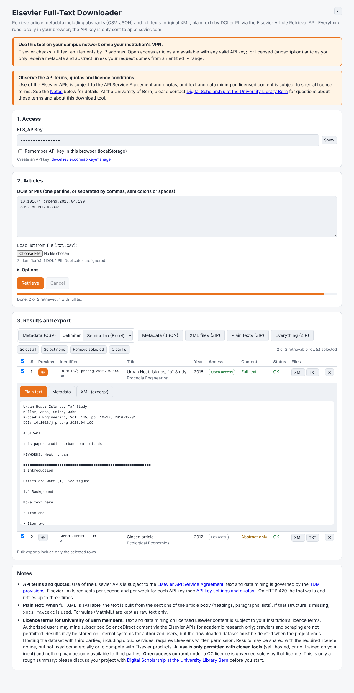

# Data tool for Elsevier ScienceDirect

## Contents

- [About](#about)
- [What can I download?](#what-can-i-download)
- [How to use](#how-to-use)
- [Quotas](#quotas)
- [Terms of use and licence](#terms-of-use-and-licence)
- [Credits](#credits)

Download article metadata including abstracts (CSV, JSON) and full texts (original XML, plain text) by DOI or PII from the [Elsevier Article Retrieval API](https://dev.elsevier.com/documentation/ArticleRetrievalAPI.wadl), directly in the browser, without programming and without installation.

**▶ Open the tool:** [k-woitas.github.io/elsevier-tool](https://k-woitas.github.io/elsevier-tool/)

## About

Elsevier offers APIs for text and data mining on ScienceDirect content. The Article Retrieval API delivers metadata, abstracts and, where you are entitled to them, full texts of journal articles and book chapters. This tool makes this interface usable through a simple form: enter your API key and a list of DOIs or PIIs, retrieve, check the results and download what you need.

## What can I download?

| Content | Source | Formats |
|---|---|---|
| Metadata and abstracts | Article Retrieval API | CSV, JSON |
| Full text | Article Retrieval API (open access and entitled subscription content) | original XML (one file per article) |
| Plain text | derived from the XML, or directly from the API (`text/plain`) | TXT, optionally with header (title, authors, source, abstract, keywords), figure and table captions and reference list |

- Input: DOIs, PIIs (with or without punctuation), `doi.org` links and `sciencedirect.com/science/article/pii/…` links, typed in or loaded from a `.txt` or `.csv` file.
- For each article, the result list shows whether the full text or only the abstract was delivered.
- Rows can be ticked and removed; bulk exports (CSV, JSON, XML as ZIP, plain texts as ZIP, everything as ZIP) include only the selected rows. CSV uses a semicolon as delimiter by default (Excel); comma and tab are available.
- A preview (plain text, metadata, XML) opens directly below each result.

## How to use

1. Get an API key at [dev.elsevier.com](https://dev.elsevier.com/apikey/manage).
2. Use the tool on your campus network or via your institution's VPN. Elsevier checks full-text entitlements by IP address; outside the entitled IP range you only receive metadata and abstracts of subscription content.
3. Open the [online version](https://k-woitas.github.io/elsevier-tool/), or download [`index.html`](index.html) and open the file in your browser.
4. Enter your API key and the DOIs or PIIs, click «Retrieve», then select the rows and download.

The tool is a single self-contained HTML file. No installation, no account. All requests go directly from your browser to `api.elsevier.com`; no data is passed on to third parties. If you tick «Remember API key», it is stored in your browser only.

If the online version reports a network error, use the downloaded file instead, or add `https://k-woitas.github.io` as a CORS domain in your [API key settings](https://dev.elsevier.com/api_key_settings.html) ([details](https://dev.elsevier.com/tecdoc_cors.html)).

## Quotas

Elsevier limits requests per second and per week for each API key (see [API key settings and quotas](https://dev.elsevier.com/api_key_settings.html)); for the Article Retrieval API these are 10 requests per second and 50,000 per week. The tool:

- sends requests one after another and waits at least 100 ms between two requests (adjustable upwards, 200 ms by default),
- waits and retries up to three times on HTTP 429.

The tool does not count requests towards the weekly quota. Each article needs one request, two if the plain text is fetched directly from the API.

## Terms of use and licence

The code in this repository is published under the [MIT License](LICENSE).

Use of the Elsevier APIs is subject to the [Elsevier API Service Agreement](https://dev.elsevier.com/api_service_agreement.html); text and data mining is governed by the [TDM provisions](https://dev.elsevier.com/tdm_service.html).

**Licence terms for University of Bern members:** Text and data mining on licensed Elsevier content is subject to your institution’s licence terms. Authorized users may mine subscribed ScienceDirect content via the Elsevier APIs for academic research only; crawlers and scraping are not permitted. Results may be stored on internal systems for authorized users, but the downloaded dataset must be deleted when the project ends. Hosting the dataset with third parties, including cloud services, requires Elsevier’s written permission. Results may be shared with the required licence notice, but not used commercially or to compete with Elsevier products. **AI use is only permitted with closed tools** (self-hosted, or not trained on your input) and nothing may become available to third parties. **Open access content** under a CC licence is governed solely by that licence. This is only a rough summary: please discuss your project with [Digital Scholarship at the University Library Bern](https://www.ub.unibe.ch/services/digital_scholarship/index_eng.html) before you start.

## Credits

Developed by Kathi Woitas at the [University Library Bern, Digital Scholarship](https://www.ub.unibe.ch/services/digital_scholarship/index_eng.html), with the support of Claude (Anthropic). As of October 2026.

Questions, suggestions and bug reports: as a [GitHub issue](https://github.com/k-woitas/elsevier-tool/issues) or via [Digital Scholarship at the University Library Bern](https://www.ub.unibe.ch/services/digital_scholarship/index_eng.html).
